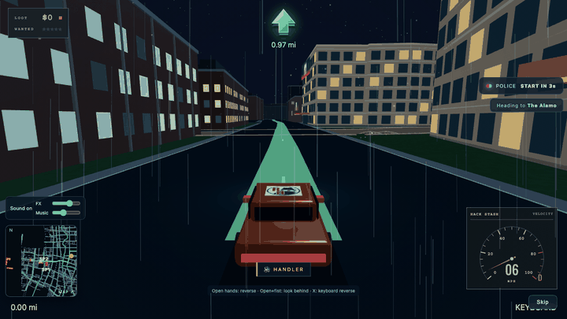
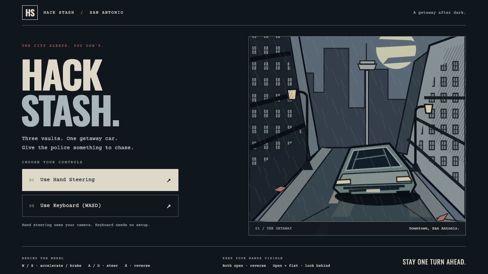
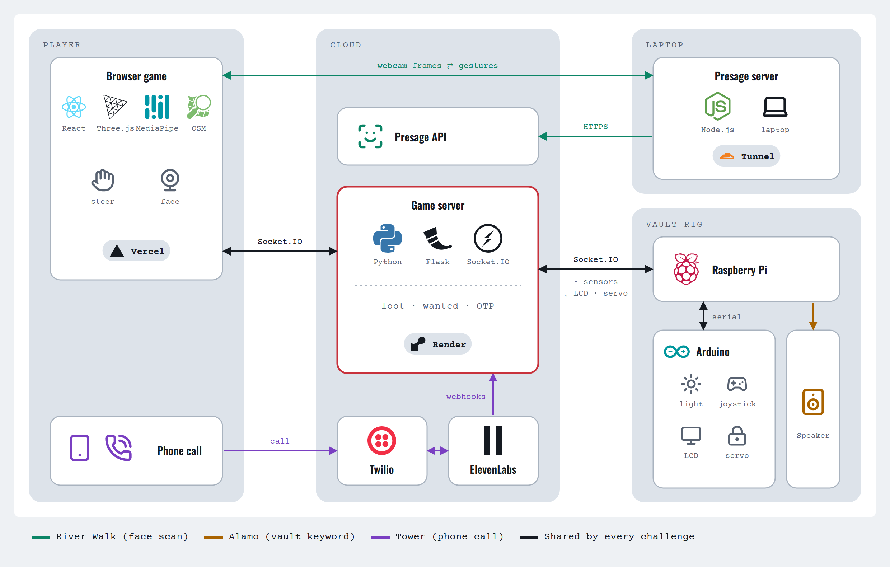

# Hack Stash (San Antonio Night Drive)

A browser getaway-driving game set in downtown San Antonio, built at RowdyHacks
(UTSA, October 2026). You steer with your hands through the webcam, follow a
routed path to three landmark "vaults", and stay ahead of a police car that
chases you along the same road graph. Each vault opens a challenge, and two of
them involve real hardware or a real phone call.

**Play it:** https://sa-night-drive.vercel.app (keyboard works too: WASD, X to reverse)





## What's in it

- **The drive** (`sa-drive/`): React Three Fiber and Three.js city built from
  OpenStreetMap exports, MediaPipe hand tracking for steering, A* routing on
  the road graph for both navigation and the police pursuit.
- **The Alamo vault** (`server/alamo_challenge.py`, `pi/`): a Simon-says puzzle
  against a physical rig. A Raspberry Pi relays an Arduino's light sensor,
  joystick, LCD and vault-door servo to the game server over Socket.IO.
- **The Riverwalk** (`server/src`): a face-scan challenge using Presage
  SmartSpectra on a separate Node.js server.
- **Tower of the Americas** (`server/tower_challenge.py`): a phone call through
  Twilio and ElevenLabs that hands out a one-time code.
- **Game server** (`server/app.py`): Flask-SocketIO, keeps loot, wanted level
  and challenge state.



The hosted demo is the browser game on its own. The vault challenges need the
game server and hardware, which ran on-site; without them the game shows a
"heist server offline" notice inside each challenge and the driving still works.

## Team

| | Main areas |
|---|---|
| **Veer Shah** ([@veermshah](https://github.com/veermshah)) | Alamo vault challenge end to end: Arduino/Raspberry Pi relay, servo, LCD and sensor protocol, server logic and tests; Render and Vercel deployment; architecture diagram. Most commits on the repo (41 of 94). |
| **Jagadeep Kalluri** ([@jagadeep298218](https://github.com/jagadeep298218)) | The driving game: city, hand steering, police pursuit, routing, art direction and branding |
| **Ishita Saran** ([@IshitaSaran](https://github.com/IshitaSaran)) | Riverwalk challenge, Presage server, narration audio, tunnels |
| **Dhivyesh Prithiviraj** ([@Dhivyeshp](https://github.com/Dhivyeshp)) | Tower of the Americas phone-call challenge |

## Run locally

```sh
cd sa-drive
npm ci
npm run dev
```

Use WASD or arrow keys to drive, hold X to reverse, and press 1-3 to select a
destination. With hand tracking, rotate your hands like a steering wheel;
open both hands to reverse and curl your fingers to drive forward.
Press R to restart and F3 for performance diagnostics.

Follow the glowing road route and stay ahead of the police. Navigation and
pursuit share an A* road graph, and buildings remain solid obstacles.

## Validate

```sh
cd sa-drive
npm run lint
npm run build
node scripts/validate-driving.mjs
node scripts/validate-gameplay.mjs
```

See [game documentation](sa-drive/README.md) for implementation notes and
validation limitations, and [credits](sa-drive/CREDITS.md) for data attribution.
